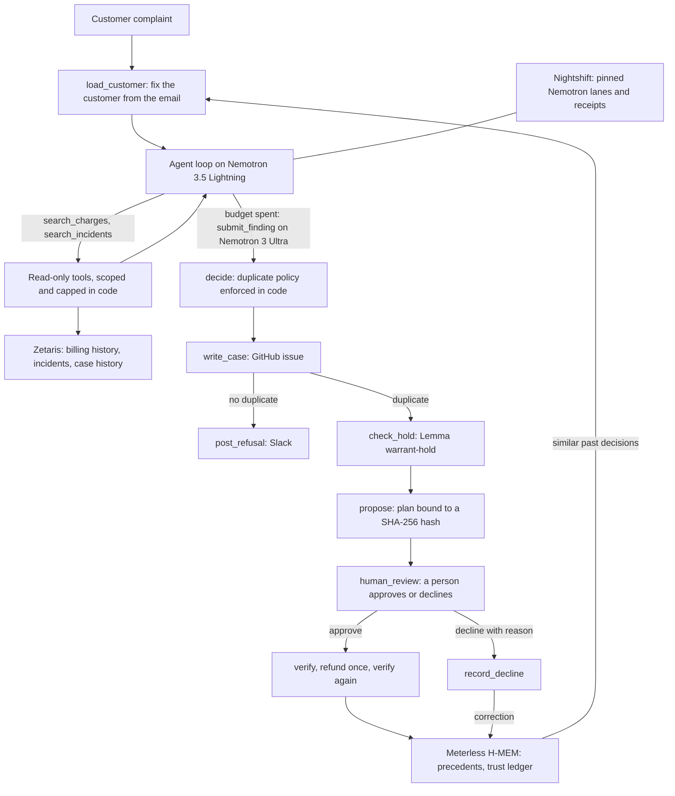
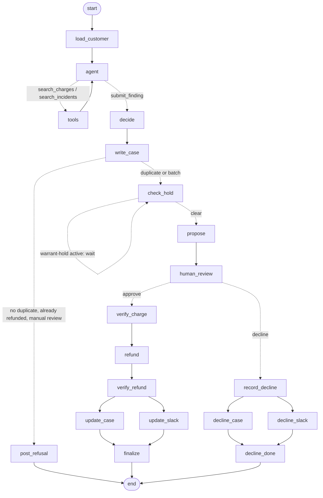

# Warrant

**An AI agent that has to earn the right to move money, and now remembers what approvers teach it.**

Warrant investigates customer reports of being charged twice. It searches the customer's billing history and engineering incidents, writes up a cited case, then either proposes an exact refund and **waits for a person to approve it**, or **refuses** and states what evidence is missing. It moves money only through an approval bound to the exact plan.

**Warrant Remembers** is the Open Agent Hackathon 2026 extension (Wildcard [Tinkerer]). Warrant existed before the hackathon; the extension adds a Zetaris evidence layer, Meterless H-MEM precedent memory, and Meterless Nightshift with NVIDIA Nemotron as the model provider. The customers are **fictional** and Stripe runs in **test mode** only.

## What was built in the hackathon

The pre-existing project is tagged [`oah-baseline`](https://github.com/calledAdo/warrant/tree/oah-baseline) (commit `d1c9ef7`, 13 September 2026). Everything below was built in the build window, 22–27 October 2026. [docs/OAH-EXTENSION.md](docs/OAH-EXTENSION.md) lists every file.

| | Before (`oah-baseline`) | After (Warrant Remembers) |
|---|---|---|
| **Evidence** | Each tool called a separate SaaS API (Stripe, GitHub) directly | Billing history, incidents and past cases are read with SQL through **Zetaris**, by read-only principals |
| **Memory** | Every case started from nothing; an approver's reason was forgotten | Approver decisions and corrections are stored in **Meterless H-MEM** with provenance and a trust ledger, retrieved for similar cases and cited by ID |
| **Models** | One OpenAI-compatible model, no compute receipts | **Nightshift** with **NVIDIA Nemotron** pinned by name: 3.5 Lightning for evidence searches, 3 Ultra for the final finding, a receipt for every call |
| **Money** | Approval bound to the plan hash, expiry, journal, idempotent refunds | Unchanged. Refunds never go through the evidence layer |

## Try it without credentials

Use Node.js 22.5 or later (it uses the built-in `node:sqlite`) and npm:

```sh
git clone https://github.com/calledAdo/warrant.git
cd warrant
npm install
npm test                                   # 60 offline tests, no accounts needed
npm run engine:conformance                 # Meterless H-MEM conformance, 13/13
npm run demo:replay                        # replay the recorded live Zetaris + Nemotron investigation
npm run demo:prepare:sqlite                # seed the fictional S1 customer locally
LLM_MODE=rules npm run start:demo:sqlite   # http://localhost:3000 and /admin
```

The offline app runs the same graph, duplicate policy, approval hash and journal against a local SQLite stand-in for Stripe, with the deterministic rules engine in place of the model. `test/memory-flow.test.mjs` runs the memory story end to end with scripted model replies: an approver declines Case A ("a plan change plus proration is not a duplicate"), and Warrant then refuses the similar Case B, citing that precedent. The same test fails when the memory store is empty. `npm run demo:replay` re-runs the recorded live investigation with no `.env` and no network: the real graph, tools and duplicate policy, fed the Zetaris query results and Nemotron replies from `data/cassettes/live-2026-10-27.jsonl`. It ends at awaiting approval with a refund proposed for `ch_demo_northwind_02`. See [docs/live-run.md](docs/live-run.md).

## Architecture



Only the agent loop is model-driven. Everything after `submit_finding`, and everything that touches money, is deterministic code. An approval is stored in H-MEM as a decision, and a decline with its reason as a correction. Both are retrieved when a similar complaint arrives.

## How the graph works

The model runs **one loop**: it chooses what evidence to look up through read-only tools that code scopes and caps, then submits a finding that code re-checks. Everything after that, and everything that touches money, is deterministic code.



| Node | What it does |
| --- | --- |
| `load_customer` | Fixes the customer from the email match. No tool can change it |
| `agent` ⇄ `tools` | **The model's loop.** Each turn the model calls `search_charges` (pages back with a cursor, optional dates), `search_incidents` (date window, keywords) or `submit_finding`. At most 8 searches, 10 charges per page, 365 days back |
| `decide` | Enforces the duplicate policy in code against **only the charges and incidents the tools returned**. Can downgrade to a refusal, *already refunded* or manual review |
| `write_case` | Creates the GitHub investigation issue |
| `check_hold` | Reads active Lemma issues. A `warrant-hold` tag, or a failed read, pauses the run here |
| `propose` / `post_refusal` | Builds the single or batch refund plan and posts it to Slack, or posts the refusal and ends |
| `human_review` | `interrupt()`: the run is checkpointed and pauses until a person approves or declines that exact plan |
| `verify_charge` | Re-checks the approval, plan hash and expiry, then re-reads every involved Stripe charge and re-runs the duplicate rule before any money moves |
| `refund` → `verify_refund` | Full refunds of the exact approved amounts, one journal entry and idempotency key per charge, then verifies `amount_refunded` on each |
| `update_case` ∥ `update_slack` | Record the outcome in GitHub and Slack, in parallel |
| `record_decline` → `decline_case` ∥ `decline_slack` | Record a decline, with the reason, in GitHub and Slack |

Run `npm run graph` to print the current graph as Mermaid.

### Safety and reliability (unchanged from the baseline)

- **Approval bound to the exact plan.** The plan ID is a full SHA-256 hash of the customer, every charge to refund, the charge being kept, amounts, currency, total and action. Approval is recorded against that hash for that run and expires after 15 minutes; if anything material changes, it no longer matches.
- **The model's tools are scoped and capped in code.** No tool accepts a customer ID. Searches are read-only, limited to 8 per investigation, 10 charges per page and 365 days back, and only what the tools returned can count as evidence.
- **The duplicate rule is enforced in code.** Matching charges must be on this account, succeeded, not refunded, and share amount and currency. The normal window is 24 hours, with a billing-related incident or identical non-empty descriptions. A window of up to 30 days also requires a shared invoice/order/checkout ID and an incident whose stated start and end cover the charges. Batches are withheld while older pages of charges are still unexplored, and are capped at 10 refunds and $1,000.
- **The complaint is untrusted input.** It is wrapped in delimiters, stripped of control characters and capped at 2,000 characters, and the policy tells the model to ignore any instructions inside it.
- **Operation journal.** Every external write records its intent before the call and its result after. Refund entries are keyed to the Stripe charge and reuse that key as Stripe's idempotency key, so a refund can't happen twice, even across runs. An ambiguous provider response is **held for a person to reconcile** (`npm run journal:reconcile`) rather than retried blindly.
- **Full refunds only, verified by amount.** During setup we found that Stripe **stacks partial refunds** made with different idempotency keys, and that a charge's `refunded` flag stays `false` after an over-refund. So Warrant sends the exact full amount, requires Stripe to report success, and checks `amount_refunded`, never the flag.
- **Partial failure is reported honestly, never rolled back.** If Slack or GitHub fails after the money moved, the run is `notification_partial`. If a batch stops partway, it's `financial_partial`, with confirmed progress shown, and stays under review. Resuming continues from the LangGraph checkpoint without repeating successful refunds.
- **Durable recovery.** Complaints, runs, approvals, journal entries and LangGraph checkpoints live in SQLite. After a restart, paused approvals, holds, partial outcomes and finished statuses are rebuilt without making any provider writes during startup. Each graph segment takes a renewable 60-second lease, so two processes can't drive the same run.
- **Audit retention.** `npm run history:archive` (a dry run unless `--apply` is given) snapshots closed runs into an audit archive before pruning only their checkpoint data. Financial journal and approval records are never routinely deleted.
- **Model outage fallback.** If the model provider is unreachable, a deterministic rules engine that applies the same policy takes over, and the admin page labels the result "Rules fallback".

## Why it matters

"You charged us twice" is one of the most common billing complaints, and one of the most awkward to handle well.

To answer it properly, someone has to look in several places:

- **Billing** (Stripe): are there really two charges? Same amount, same currency, minutes apart, or two different things that just look alike?
- **Engineering** (GitHub): was there an incident, such as a retry loop or a double-submitted invoice, that would explain it?
- **The team** (Slack): who signs off on sending money back, and how does everyone else find out?

That work is manual, spread across tools, and usually lands on whoever is on support that day. Both ways of getting it wrong cost money:

**Refunding when you shouldn't.** Two charges can look identical and still both be legitimate: a plan and an add-on, or a proration. A refund is money gone, and an automated agent that refunds whenever a customer says "duplicate" can be talked into it.

**Not refunding when you should.** A customer who is ignored or gets the wrong answer can go to their bank and dispute the charge. According to [Stripe's documentation on disputes](https://docs.stripe.com/disputes/how-disputes-work):

- the disputed amount **plus a dispute fee** is debited from the business's balance, and outside Mexico that fee is **not refunded even if you win**;
- countering the dispute adds a further fee;
- while a dispute is open you **cannot issue a refund outside the dispute process**;
- each dispute **raises your dispute rate** with the card network;
- the full process can take **2–3 months**, with only **7–21 days** to respond.

So a genuine duplicate that isn't refunded quickly can cost more than the charge itself, while a wrongful refund loses the money outright. Teams need an answer that is **fast, backed by evidence, and safe to act on**.

## Live setup

Requirements: Node.js 22.5 or newer; a Stripe account in test mode; a GitHub token with `repo` scope and a repository with Issues; a Slack app with `chat:write`; a Lemma API key and project; Zetaris running locally (REST at `http://localhost:8888/api/v1.0`); a Nightshift runtime with the NVIDIA provider; and the PostgreSQL and SeaweedFS containers from [Lotline](https://github.com/calledAdo/lotline). Optional: an Arga account for the Slack twin.

```sh
cp .env.example .env                       # fill in locally; never commit it
npm install
node scripts/setup-zetaris.mjs             # warrant database, Zetaris datasource
node scripts/setup-principals.mjs          # wr_evidence and wr_history, SELECT only
node scripts/sync-evidence.mjs             # Stripe and GitHub evidence into Zetaris
WARRANT_USE_ZETARIS=true npm run start:demo
```

| Variable | Value |
| --- | --- |
| `STRIPE_SECRET_KEY` | Must start with `sk_test_`. The scripts refuse live keys |
| `GITHUB_TOKEN`, `GITHUB_REPO` | Token with `repo` scope, and `owner/name` of the cases repository |
| `SLACK_BOT_TOKEN`, `SLACK_CHANNEL` | `xoxb-…` token, and the channel in quotes, e.g. `"#billing-approvals"` |
| `SLACK_API_URL` | Leave empty for real Slack; set to an Arga twin URL to use the twin |
| `LEMMA_API_KEY`, `LEMMA_PROJECT_ID` | From Lemma project settings |
| `LLM_MODE` | `llm` to use the model, `rules` for the deterministic engine |
| `LLM_FALLBACK` | Set to `off` to fail instead of falling back to rules when the model is unreachable |
| `WARRANT_DB` | Path of the SQLite database (the demo scripts set their own) |
| `WARRANT_PROVIDER` | `live` for real Stripe/GitHub/Slack, `sqlite` for the local stand-in |
| `WARRANT_DEMO` | `s1` limits the demo pages and reset to the S1 scenario |
| `WARRANT_USE_ZETARIS` | `true` to route evidence reads through Zetaris (default: false) |

**Nightshift / Meterless (required for live model calls):**

| Variable | Value |
| --- | --- |
| `METERLESS_BASE_URL` | Nightshift OpenAI-compatible endpoint, e.g. `http://127.0.0.1:8088/v1` |
| `METERLESS_RUNTIME_TOKEN` | Nightshift runtime token |
| `WARRANT_METERLESS_APP_ID` | Application ID for Nightshift (default: `warrant`) |
| `NIGHTSHIFT_FAST_MODE` | `nvidia/nemotron-3.5-lightning-30b-a3b` (pinned) |
| `NIGHTSHIFT_DEEP_MODE` | `nvidia/nemotron-3-ultra-550b-a55b` (pinned) |

**Zetaris (required for live evidence layer):**

| Variable | Value |
| --- | --- |
| `ZETARIS_REST_URL` | `http://localhost:8888/api/v1.0` |
| `ZETARIS_ORG_ID` | `1` |
| `ZETARIS_API_KEY` | Admin API key (setup only) |

**S3 / SeaweedFS (for evidence snapshots):**

| Variable | Value |
| --- | --- |
| `S3_ACCESS_KEY` | SeaweedFS access key |
| `S3_SECRET_KEY` | SeaweedFS secret key |

**PostgreSQL (warrant database):**

| Variable | Value |
| --- | --- |
| `WARRANT_DB_USER` | PostgreSQL user for the `warrant` database |
| `WARRANT_DB_PASSWORD` | Its password |

**Zetaris principals (generated locally, never committed):**

| Variable | Value |
| --- | --- |
| `ZETARIS_WR_EVIDENCE_USER` | `wr_evidence@local.test` |
| `ZETARIS_WR_EVIDENCE_PASSWORD` | Generated by `scripts/setup-zetaris.mjs` |
| `ZETARIS_WR_HISTORY_USER` | `wr_history@local.test` |
| `ZETARIS_WR_HISTORY_PASSWORD` | Generated by `scripts/setup-zetaris.mjs` |

**H-MEM:**

| Variable | Value |
| --- | --- |
| `WARRANT_HMEM_DIR` | `data/hmem` (precedent JSONL store) |

### Run the integrated app

```bash
npm run verify              # check the Stripe, GitHub and Slack credentials end to end
npm run lemma:policy        # upload the policy to Lemma as agent context
npm run demo:prepare        # fresh Stripe test customer, duplicate charges and GitHub incident
npm run start:demo          # http://localhost:3000
```

Open `/simulation` and click **Pay** to create two Stripe test charges, follow **Multiple charge? Ask for a refund** to the prefilled complaint, then approve on `/admin`. Use **Reset Demo Data** on `/admin` before each new take.

To run the general app with all three seeded customers instead:

```bash
npm run fixtures:demo       # Northwind (S1), Harbor (S2), Lakeside (S6); ~30 s
npm start                   # http://localhost:3000 and /admin
```

Try `billing@northwind.test` (a genuine duplicate: approve it on `/admin`), `ap@harbor.test` (not a duplicate: refused automatically) and `finance@lakeside.test` (a duplicate buried under 22 newer charges: watch the agent page back to find it).

### Run the reliability tests

```bash
npm test                                         # offline suite
npm run fixtures && node verify/e2e.mjs          # live S1–S3 and S6 (S4 is opt-in)
node verify/e2e.mjs --scenario=s1                # a single live scenario
npm run fixtures && npm run verify:injection     # S5 prompt injection
npm run verify:llm <base_url> <key> <model>      # check a model refuses correctly and picks the later charge

# S4 without an Arga account, using the local Slack twin stand-in
MOCK_SLACK_WINDOW=6 node verify/mock-slack.mjs &
SLACK_API_URL=http://localhost:4020 SLACK_CHANNEL=billing-approvals node verify/e2e.mjs --scenario=s4

# S4 against Arga's Slack twin
arga twin-runs create --twins slack --ttl 10 --wait --json \
  --scenario-prompt "A Slack workspace with a channel named billing-approvals. Enable rate limiting with a strict limit on the chat.update method: at most 1 request per 20 seconds."
# then set SLACK_API_URL and SLACK_BOT_TOKEN from the output and run: node verify/e2e.mjs --scenario=s4
```

Operations commands:

```bash
npm run lemma:issues                       # read active Lemma issues
npm run journal:reconcile -- <op-key>      # inspect and reconcile an ambiguous journal entry
npm run history:archive -- --days=90       # dry run; add --apply to archive
npm run graph                              # print the LangGraph as Mermaid
```

## Sponsor technology

**Zetaris.** A JDBC datasource over the `warrant` PostgreSQL database exposes `warrant_db.billing_history`, `warrant_db.engineering_incidents` and `warrant_db.case_history`. `scripts/sync-evidence.mjs` fills it from Stripe test mode (or the SQLite stand-in) and GitHub, and also writes snapshot files under `s3://lotline/warrant/`. At runtime the agent's tools query Zetaris as two least-privilege users: `wr_evidence` (role `warrant_evidence`, SELECT on billing history and incidents) and `wr_history` (role `warrant_history`, SELECT on case history). Set `WARRANT_USE_ZETARIS=true` to route evidence reads through Zetaris. The tools return exactly the same shape as the direct Stripe path, so the duplicate policy is unchanged.

**Meterless H-MEM.** The Apache-2.0 reference at upstream commit `1742dec56a66e58eef9dda2d2b865823758ca8cd` is vendored in [engines/hmem](engines/hmem/) with its LICENSE, NOTICE and upstream commit. Warrant replaces the upstream whole-file state with an append-only `events.jsonl` and `ledger.jsonl` that tolerate a torn final line. The upstream conformance suite runs unmodified: 13/13.

**Nightshift and NVIDIA.** Every model call goes through Nightshift's OpenAI-compatible `/chat/completions` API, with the models pinned by name: `nvidia/nemotron-3.5-lightning-30b-a3b` runs the evidence-search turns (with `chat_template_kwargs.enable_thinking=false`), and once the search budget is spent, `nvidia/nemotron-3-ultra-550b-a55b` is offered only `submit_finding` and writes the finding. Generic routing aliases are deliberately avoided. Each call records its receipt ID, routed model, provider, latency and tokens in the trace.

See [the Zetaris Unified Semantic Layer write-up](docs/zetaris-usl.md) (sources, DDL, the duplicate-candidates view, live query results, data quality rules, time saved, and a feature requirement) and [the standalone sponsor explanation](docs/sponsor-tech.md).

### Where the engine is used (judges look here)

| Feature | Engine use | Code |
|---|---|---|
| Similar past decisions in the prompt | `query` retrieval, reinjected as `<relevant_precedents>` | `src/hmem-precedent.js`, `src/agent-tools.js` |
| Approver approves a refund | `add` a decision with provenance; ledger `create` | `src/graph.js`, `src/hmem-precedent.js` |
| Approver declines, with a reason | `add` a correction that outranks the original finding | `src/graph.js`, `src/hmem-precedent.js` |
| Finding cites the precedent | Memory ID in the finding's grounds | `src/agent-tools.js` |
| Precedent against current policy | Conflict detection flags contradicting precedents | `src/hmem-precedent.js` |
| Durable across restarts | Append-only events and ledger | `engines/hmem/src/memoryStore.ts` |

## Evaluation

```sh
npm test
npm run engine:conformance
npx tsc
```

- **Offline tests:** 60 pass. The baseline suite covers the duplicate policy, batches and caps, the approval hash, the operation journal, crash recovery, run leases, Lemma holds and audit retention. The extension adds the Zetaris evidence path, the per-principal policy, H-MEM retrieval, receipts, precedent formatting, Zetaris row mapping (UTC times, string booleans), and the memory-changes-decision flow, including the failure when memory is empty.
- **H-MEM conformance:** 13/13 upstream checks pass.
- **Live run (27 October 2026):** one complaint end to end through Zetaris and Nightshift, investigation only, at a fixed clock so it replays exactly (`npm run demo:replay`). Five Nemotron Lightning search turns and one Nemotron Ultra finding, six receipts, and eight Zetaris queries as `wr_evidence`. Verdict: duplicate, refund `ch_demo_northwind_02`: two identical 49.00 USD charges 43 seconds apart. The code check accepted it, and the run stopped at awaiting approval. Nothing was refunded. Details: [docs/live-run.md](docs/live-run.md).

### Live scenarios (baseline, Stripe test mode, GitHub and Slack)

Seeded customers are clearly labelled `(SEEDED FIXTURE)`.

| Scenario | Setup | What must happen | Result |
| --- | --- | --- | --- |
| **S1: genuine duplicate** | Two identical $49 charges one second apart, plus a matching GitHub incident | Proposal, approval, one refund, `amount_refunded` verified, the legitimate charge untouched | Pass |
| **S2: not a duplicate** | $49 plan charge and $73 overage charge, no incident | Refused; case still written with the missing evidence stated; no plan, no money moved | Pass |
| **S3: replay** | After S1, fork the LangGraph thread from the checkpoint **just before the refund** and run forward again | The graph re-enters the refund step; the journal blocks a second refund; exactly one refund operation | Pass |
| **S4: Slack fails after the refund** | Slack rate-limits `chat.update` (HTTP 429) after the refund succeeded | Partial status, refund **not** rolled back; resume finishes the follow-up; refund and GitHub comment each happen exactly once | Pass. Verified on Arga's Slack twin before the LangGraph migration, and on the local twin stand-in since |
| **S5: prompt injection** | 8 forged "duplicate" findings, plus a live complaint against S2's charges that fakes the closing tag and orders an immediate refund | Every forged finding rejected with the right reason, the genuine one allowed, and the live attack refused with no plan and no money moved | Pass |
| **S6: duplicate beyond the 20 most recent charges** | A genuine $129 duplicate pair with 22 newer usage charges on top | The model pages back, finds the buried pair and refunds the later charge; the test also proves a flat "last 20 charges" fetch would have missed it | Pass (3 charge searches, 24 charges seen, 1 incident search) |
| **Decline** | A person declines a proposed refund with a reason | The graph resumes into the decline branch; GitHub and Slack record who and why; no money moved | Pass |

### What testing taught us

- **Lemma caught real bugs, and we fixed them.** With our policy uploaded, Lemma flagged cases titled "no duplicate found" where a duplicate existed but had already been refunded; there is now a distinct *already refunded* outcome. It also flagged "refund without authorization in the transcript", because execute traces didn't show the approval; they now include an `approval-check` span and every model turn's full prompt. It flagged S3's replay re-verifying a refund too, which is expected, so the policy now says so.
- **Stripe stacks partial refunds silently.** Two $30 refunds on a $100 charge with different idempotency keys gave `amount_refunded = 6000` with `refunded: false` and no error. This is why Warrant only issues exact full refunds.
- **LangGraph checkpoints alone don't prevent duplicate writes.** When Slack failed alongside the GitHub update, resuming re-ran the GitHub step that had already finished; the journal skipped it, so the comment was posted once. Checkpoints resume the run; the journal makes each write happen once.
- **An in-flight write must not count as done.** S4 exposed a resume arriving during an unfinished write and reporting success. Unconfirmed writes now stay pending until reconciled.
- **Arga's Slack twin produces a real, recoverable fault.** Seeded with a rate limit, `chat.update` returned HTTP 429 with `Retry-After`, then succeeded after the window with the message timestamp preserved.
- **A fixed "last 20 charges" fetch misses real duplicates.** S6 proves it, which is why evidence gathering became a tool loop the model controls.
- **Groq's free tier couldn't carry the tool loop.** `gpt-oss-120b` handled a single prompt in 2–3 s, but the multi-turn loop hit its 8,000 tokens-per-minute cap. Groq also rejects tool calls with `null` optional arguments, and `gpt-oss` sometimes emitted its answer under a tool name that doesn't exist. Warrant now accepts nulls, waits and retries on rate limits, and recovers the intended call from the provider's `failed_generation`. The baseline agent ran on `gpt-5.6-luna`; it now runs on Nemotron through Nightshift.

## Data, licences and pre-existing work

The demo customers, charges and incidents are fictional and run in Stripe test mode; the scripts refuse live Stripe keys. No personal data is included.

Declared pre-existing components: the Warrant baseline at tag `oah-baseline` (13 September 2026), and the Meterless H-MEM reference, vendored under Apache-2.0. The Zetaris client and Nightshift client patterns are adapted from the same author's hackathon project [Lotline](https://github.com/calledAdo/lotline). Package dependencies are third-party components listed in the lockfile.

## Limitations and security

- Runtime Zetaris principals are read-only by design. Case outcomes are written directly to the `warrant` PostgreSQL database that Zetaris serves, and the next read through Zetaris sees them.
- The Zetaris evidence path reads synced snapshots of Stripe and GitHub, not live tables.
- The offline web app uses the rules engine. The model path runs offline only as the exact replay of the recorded live run, and the memory flow is exercised by a test with scripted model replies.
- SQLite storage and leases support one host. A multi-host deployment needs runs, leases, checkpoints, approvals and the journal in one shared transactional database.
- Ambiguous provider writes need a person to reconcile them (`npm run journal:reconcile`). Approval happens on `/admin`, not in Slack. The customer's email is not verified before a complaint is accepted.
- `.env`, local databases and the H-MEM store are ignored by git. The recorded cassette contains model request and response bodies only, never authorization headers.

## Project layout

```
src/
  graph.js            LangGraph state graph: agent/tools loop, Lemma hold, human review, refund and decline branches
  run.js              investigate / approve / execute / resume / decline / replay, status derivation
  agent-tools.js      the model's tools, scoping and caps, finding parser, recovery of malformed tool calls
  duplicate-policy.js the duplicate rule, batch grouping, extended window and caps
  agent.js            complaint sanitising
  agent-rules.js      deterministic fallback applying the same policy
  outcomes.js         outcome labels (already refunded, multiple duplicates, manual review, …)
  policy.md           the agent's rules (also uploaded to Lemma)
  plan.js             plan hashing, approval expiry and renewal
  journal.js          operation journal
  checkpointer.js     durable LangGraph checkpoints
  storage.js          SQLite schema and persistence
  coordinator.js      renewable run leases
  retention.js        audit archive
  lemma-issues.js     Lemma issue reads, per-trace occurrences and warrant-hold
  trace.js            Lemma tracing
  complaints.js       complaints and the customer-facing view
  application.js      shared workflow functions used by the server and demo
  simulation.js       Stripe test-mode payment for the demo
  demo.js, demo-live.js, demo-store.js   S1 demo preparation (integrated and SQLite)
  server.js           HTTP API and pages
  adapters/           stripe.js, github.js, slack.js
  zetaris.js          Zetaris REST client, per-agent login              (new)
  evidence.js         evidence reads through Zetaris                    (new)
  evidence-policy.js  which tables each Zetaris principal may read      (new)
  hmem-precedent.js   precedent memory on Meterless H-MEM               (new)
  cassette.js         records model and SQL calls                       (new)
public/               simulation.html, index.html (customer), admin.html (billing team), app.css
test/                 offline test suite (npm test)
verify/               live credential checks, scenario tests, injection test, Slack twin stand-in
scripts/              setup-zetaris, setup-principals, sync-evidence (new); Lemma policy upload and issue reader, demo preparation, journal reconcile, archive, graph printer
fixtures/             seeds the test customers and incidents
docs/                 OAH-EXTENSION.md (baseline vs new), sponsor-tech.md, live-run.md, operations guide
engines/hmem/         vendored Meterless H-MEM reference, conformance suite (new)
data/cassettes/       the recorded live run (new)
llmtimeline/          cross-agent work record
```

